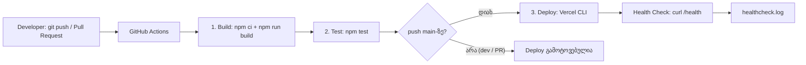
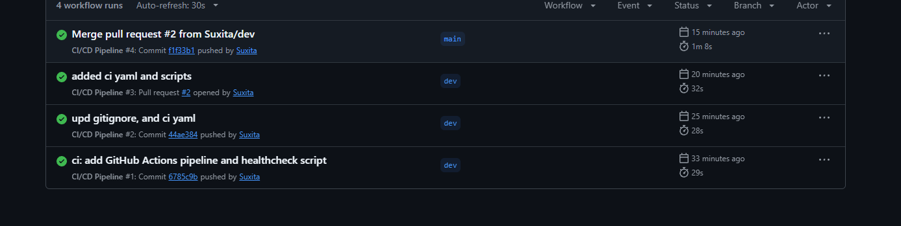
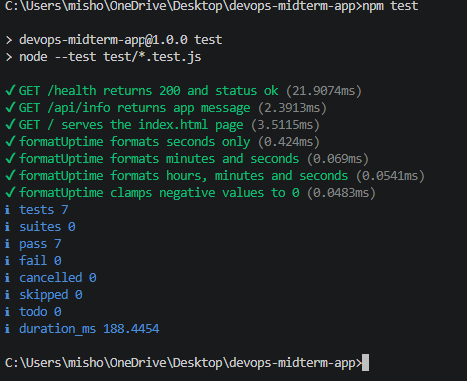
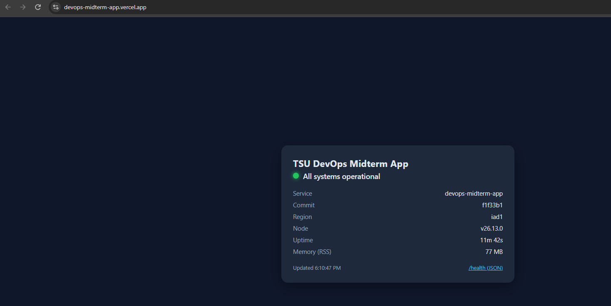

# DevOps შუალედური პროექტი

მცირე Node.js (Express) აპლიკაცია `/health` ენდფოინთით და სტატუსის გვერდით, რომელიც ავტომატურად დაიბილდება, გაიტესტება და დადეფლოიდდება Vercel-ზე GitHub Actions-ის პაიპლაინით.

**ცოცხალი აპლიკაცია:** https://devops-midterm-app.vercel.app

## პროექტის აღწერა

აპლიკაცია გვაწვდის:

- `/` – სტატუსის გვერდი (`public/index.html`), რომელიც ყოველ 10 წამში ამოწმებს `/health`-ს და აჩვენებს სერვისის მდგომარეობას;
- `/health` – JSON პასუხი სერვისის სტატუსით, ვერსიით, გარემოთი, uptime-ითა და მეხსიერებით;
- `/api/info` – მარტივი საინფორმაციო ენდფოინთი.

**გამოყენებული ინსტრუმენტები:** Node.js, Express, `node:test` (ტესტები), Git/GitHub, GitHub Actions (CI/CD), Vercel (დეპლოიმენტი), Bash + curl (მონიტორინგი).


## ლოკალურად გაშვება

```bash
npm install
npm test
npm start        # http://localhost:3000
```

## Git ბრენჩები

- `main` – სტაბილური ვერსია, მხოლოდ აქედან ხდება დეპლოი;
- `dev` – სამუშაო ბრენჩი; ცვლილებები `main`-ში Pull Request-ით გადადის.

## CI/CD პროცესი

Workflow ფაილი: `.github/workflows/ci.yml`. პაიპლაინი ავტომატურად გაიშვება `main` და `dev` ბრენჩებზე ყოველი push-ის და Pull Request-ის დროს.

1. **Build** – გარემოს მომზადება (Node.js 20), დამოკიდებულებების დაინსტალირება (`npm ci`) და აპლიკაციის ჩატვირთვის შემოწმება (`npm run build`).
2. **Test** – იწყება Build-ის შემდეგ; უშვებს ავტომატურ ტესტებს (`npm test`).
3. **Deploy** – იწყება Test-ის შემდეგ და **მხოლოდ `main`-ზე push-ის დროს**: Vercel CLI-ით აკეთებს production დეპლოის, შემდეგ კი უშვებს health check-ს დადეპლოებულ აპლიკაციაზე და ინახავს ლოგს.

### Workflow დიაგრამა



## სქრინშოტები

### 1. წარმატებით გავლილი CI/CD პაიპლაინი

GitHub Actions Build, Test და Deploy.



### 2. იუნიტ ტესტების გაშვება

`npm test` 



### 3. მომუშავე აპლიკაცია

აპლიკაცია მუშაობს



## მონიტორინგი და Health Check

სკრიპტი `scripts/healthcheck.sh` ამოწმებს `<URL>/health`-ს (მაქსიმუმ 5 მცდელობა, 5 წამის ინტერვალით) და შედეგებს წერს ლოგ ფაილში. წარუმატებლობის შემთხვევაში სკრიპტი ბრუნდება კოდით `1`, რის გამოც პაიპლაინი წითლდება.

```bash
bash scripts/healthcheck.sh https://devops-midterm-app.vercel.app logs/healthcheck.log
```

ლოგის მაგალითი ინახება `logs/healthcheck.log` ფაილში. პაიპლაინი ყოველ დეპლოიზე იგივე ლოგს ტვირთავს GitHub Actions-ის artifact-ად (`healthcheck-log`).

## ბონუსი

- სტატუსის გვერდი (`/`) – მარტივი ვიზუალური დეშბორდი, რომელიც ავტომატურად განახლდება.